# 🎓 Madhyamik AI Mitra (মাধ্যমিক এআই মিত্র)

<p align="center">
  
</p>

<p align="center">
  <strong>An autonomous, bilingual study and exam research companion built specifically for West Bengal Board (WBBSE) Class 10 candidates.</strong>
</p>

<p align="center">
  <a href="https://madhyamik-ai-mitra.onrender.com/"></a>
</p>

<p align="center">
  <a href="https://wbbse.wb.gov.in/"></a>
  <a href="https://react.dev/"></a>
  <a href="https://www.typescriptlang.org/"></a>
  <a href="https://vite.dev/"></a>
  <a href="https://tailwindcss.com/"></a>
  <a href="https://ai.google.dev/"></a>
  <a href="https://openrouter.ai/"></a>
  <a href="https://firebase.google.com/"></a>
</p>

---

## 🌟 Live Demo

Experience the live web app in action:  
👉 **[https://madhyamik-ai-mitra.onrender.com/](https://madhyamik-ai-mitra.onrender.com/)**

> **Note for Visitors:** On Render's free tier, the web service spins down after inactivity. If the page takes ~30–45 seconds to load initially, the container is simply waking up.

---

## 📑 Table of Contents

- [🌟 Live Demo](#-live-demo)
- [💡 Why Madhyamik AI Mitra?](#-why-madhyamik-ai-mitra)
- [🚀 Core Features](#-core-features)
  - [1. 10-Year PYQ Bank & ABTA/WBTA Frequency](#1--10-year-pyq-bank--abtawbta-frequency-intelligence)
  - [2. Universal Real-Time Token Streaming (Guest & Logged-In)](#2--universal-real-time-token-streaming-guest--logged-in)
  - [3. Interactive Blackboard Teacher (ব্ল্যাকবোর্ড শিক্ষক)](#3--interactive-blackboard-teacher-ব্ল্যাকবোর্ড-শিক্ষক)
  - [4. Professional Live Voice Viva Prep Suite](#4--professional-live-voice-viva-prep-suite)
  - [5. True Bilingual Mirroring & Banglish Transliteration](#5--true-bilingual-mirroring--banglish-transliteration)
  - [6. Multi-Format Paper & Syllabus Upload](#6--multi-format-paper--syllabus-upload)
  - [7. Hallucination-Free YouTube Grounding](#7--hallucination-free-youtube-educational-grounding)
  - [8. Guest Student Mode & Cloud Persistence](#8--guest-student-mode--cloud-persistence)
- [📱 Mobile App & PWA Installation](#-mobile-app--pwa-installation)
- [🏗️ System Architecture](#️-system-architecture)
- [🛠️ Tech Stack & Libraries](#️-tech-stack--libraries)
- [📡 Key API & Protocol Reference](#-key-api--protocol-reference)
- [⚡ Getting Started (Local Development)](#-getting-started-local-development)
- [🧪 Testing & Verification](#-testing--verification)
- [🌐 Production Deployment](#-production-deployment)
- [🔒 Security & Privacy](#-security--privacy)
- [👨‍💻 Author & Acknowledgments](#-author--acknowledgments)

---

## 💡 Why Madhyamik AI Mitra?

Every year, over **10 lakh students** across West Bengal sit for the **Madhyamik Pariksha** (WBBSE Class 10 secondary examination). For most students in government and rural schools, this is the very first high-stakes board examination of their lives.

Generic AI chatbots often fail Madhyamik candidates:
- They explain concepts using CBSE/ICSE terms and out-of-syllabus textbooks.
- They give bulky, delayed batch output rather than responsive real-time streaming.
- They cannot break down Bengali numericals from physical science or theorem proofs step-by-step.
- They lack awareness of test-paper patterns from **ABTA** (All Bengal Teachers' Association) and **WBTA** (West Bengal Teachers' Association).
- Spoken audio often mispronounces Bengali and Banglish greetings (e.g. reading *"kemon acho"* as *"kemono achio"* using English phonetics).
- They provide zero oral viva practice for school tests and board evaluations.

**Madhyamik AI Mitra** was handcrafted to solve these exact hurdles. It pairs a **10-Year WBBSE PYQ database (2016–2026)** with real-time **Gemini 3.1 Flash Lite SSE token streaming**, an **Unlimited OpenRouter Live Voice mode**, and **Microsoft Edge 24kHz Studio Bengali Neural Voices**, offering students a patient, bilingual digital tutor that sounds authentic and writes just like a supportive teacher at a green chalkboard.

---

## 🚀 Core Features

### 1. 📚 10-Year PYQ Bank & ABTA/WBTA Frequency Intelligence
- Direct chapter-wise indexing across **all 7 WBBSE subjects**:
  - *Physical Science (ভৌত বিজ্ঞান)*
  - *Life Science (জীবন বিজ্ঞান)*
  - *Mathematics (গণিত)*
  - *History (ইতিহাস)*
  - *Geography (ভূগোল)*
  - *Bengali (বাংলা)*
  - *English (ইংরেজি)*
- Classifies each query by board pattern: **1-Mark MCQs / VSA**, **2-Mark Concept Questions**, **3-Mark & 5-Mark Numericals / Broad Questions**, and **8-Mark History Essays**.
- Real-time badges indicate:
  - `High Probability (সম্ভাব্য প্রশ্ন)`: Recurring themes across consecutive board sessions.
  - `Repeated Trend (পুনরাবৃত্ত প্রশ্ন)`: Common questions spotted across ABTA and WBTA test papers.
  - `Concept Builder (ধারণা স্পষ্টীকরণ)`: Foundational topics required to score 90%+ in Madhyamik.

### 2. ⚡ Universal Real-Time Token Streaming (Guest & Logged-In)
- **Zero Batch Output**: Both guest mode and logged-in Google accounts receive token-by-token streaming over HTTP Server-Sent Events (`text/event-stream`).
- **Ultra-Low TTFT (Time-To-First-Token)**: Powered by `gemini-3.1-flash-lite`, the first token begins rendering in **~1.5 to 2.5 seconds**.
- **Interactive Typing Indicator & Cursor**: Displays a gentle *"মিত্র উত্তর তৈরি করছে... (Mitra is researching...)"* pulse, followed by live markdown text with an animated blinking cursor (`▌`).
- **Internal Fence Shielding (`stripInternalFences`)**: Automatically cleans internal JSON configuration blocks in real time so students only see polished Bengali/English prose.
- **Tiered Multi-Model Fallback**: Automatically degrades to `gemini-3.8-flash` and `gemini-4-hydrogen` with low thinking levels if upstream rate limits occur.

### 3. 🟢 Interactive Blackboard Teacher (ব্ল্যাকবোর্ড শিক্ষক)
- Dedicated step-by-step problem solver exclusively for **Mathematics** and **Physical Science**.
- Modeled after a supportive teacher standing at a green chalkboard:
  - Breaks long equations, chemical balancing, and theorem proofs into **digestible chalk sections** instead of overwhelming students with walls of text.
  - Requires the student to confirm understanding (*"আমি বুঝতে পেরেছি, পরবর্তী ধাপে চলুন"* / *"পরের ধাপ"*) before moving forward.
  - **Dynamic Simplification (Levels 1–5)**: If a student clicks *"সহজ ভাষায় বোঝান"*, the tutor rewrites the step using intuitive real-world analogies (e.g., using coins, tea cups, or football fields).
  - **Authentic Chalkboard Speech Synthesis**: Reads chalkboard equations, formulas, and steps aloud using phonetically normalized Bengali and English mathematical audio.

### 4. 🎙️ Professional Live Voice Viva Prep Suite
- **Dual Live Voice Engines**:
  - **Gemini Live WebSocket**: Bidirectional low-latency oral examination powered by `gemini-3.8-live` over persistent WebSockets (`/api/live-ws`).
  - **Unlimited OpenRouter Live Mode**: Cost-effective unlimited viva mode powered by high-speed open models (`liquid/lfm-7b-chat`, `deepseek/deepseek-chat`, `meta-llama/llama-3.3-70b-instruct`) with live Edge Neural Voice readout.
- **Edge 24kHz Studio Neural Bengali Voices**: Uses `bn-IN-BashkarNeural` and `bn-IN-TanishaaNeural` for natural, traditional Bengali pronunciation without robotic artifacts.
- **Seamless 0ms Audio Prefetching**: Audio chunks are proactively fetched while the current sentence is playing, completely eliminating awkward silence gaps or stuttering between sentences.
- **In-Modal Bilingual Switcher**: Dynamic `[ বাংলা ]` `[ English ]` toggle directly inside the modal header so students can switch languages at any moment without leaving the viva.
- **Subject-Tailored Viva Prompt Chips**: One-tap quick start questions for all 7 WBBSE subjects (e.g. Boyle's/Charles's Law, Ohm's Law & resistance numericals, Mitosis vs Meiosis, Quadratic equation discriminant, *Koni* & Kshitis Sinha character questions).
- **Golden Examiner Rating Badge**: Automatically extracts and highlights examiner marks (e.g. `🏆 পরীক্ষক মূল্যায়ন: ৪ / ৫ নম্বর`) whenever the AI scores the student's answer.
- **Manual Typing Bar**: Allows students to type answers directly if they are in a noisy classroom or have mic restrictions.

### 5. 🗣️ True Bilingual Mirroring & Banglish Transliteration
- **Banglish Transliteration Engine**: Automatically detects and transliterates conversational Latin-script Banglish into authentic Bengali Unicode (`"kemon acho"` $\to$ `"কেমন আছো"`, `"tumi kemon acho"` $\to$ `"তুমি কেমন আছো"`, `"ami bhalo achi"` $\to$ `"আমি ভালো আছি"`, etc.).
- **Voice Mismatch Protection**: If the student's speech contains Bengali script or Banglish greetings, the audio synthesis engine automatically enforces `lang = 'bn'`, ensuring the studio Bengali neural voice is chosen instead of an English voice mispronouncing words as *"kemono achio"*.
- **Phonetic Formula Normalizer**: Translates LaTeX equations ($P_1V_1 = P_2V_2$, $ax^2 + bx + c = 0$), Greek letters ($\alpha, \beta, \theta, \Omega$), and chemical formulas ($CH_4, H_2SO_4, CaCO_3$) into authentic Bengali speech.

### 6. 📄 Multi-Format Paper & Syllabus Upload
- Students can upload snapshots or documents of homework questions, textbook pages, and school test papers.
- Supports **Images (`.png`, `.jpg`, `.webp`)**, **PDFs (`.pdf`)**, and **Text notes (`.txt`)**.
- The server extracts the problem statement, identifies the chapter, and maps it directly against the WBBSE syllabus.

### 7. 🎥 Hallucination-Free YouTube Educational Grounding
- Curated video lectures aligned with WBBSE Class 10 concepts.
- Every YouTube link is actively validated via YouTube's oEmbed protocol before being rendered, completely eliminating broken, private, or hallucinated video embeds.

### 8. 🔐 Guest Student Mode & Cloud Persistence
- **Instant Guest Mode**: Students can jump in, ask questions, solve problems, and practice voice viva immediately with zero friction using local storage.
- **Google Sign-In**: Optional Google OAuth login synchronizes study sessions, uploaded papers, and chat history seamlessly across phones, tablets, and laptops via hardened Cloud Firestore rules.

---

## 📱 Mobile App & PWA Installation

Madhyamik AI Mitra is fully responsive and optimized for mobile devices:

### 1. 100% Free Progressive Web App (PWA)
- **On Android**: Open the website in Google Chrome $\to$ tap the **"Install app"** banner or Chrome menu $\to$ **"Add to Home screen"**. It installs a standalone app on your phone launcher.
- **On iPhone / iPad (iOS)**: Open the website in Safari $\to$ tap the **Share** button $\to$ tap **"Add to Home Screen"**.
- **Benefits**:
  - Launches in full-screen standalone mode with no browser URL bars.
  - Instant updates: whenever new features are pushed, mobile users receive them immediately without manual app store updates.
  - Native microphone and audio support for Live Voice Viva.

### 2. Native Android & iOS App (Capacitor)
The project is built with clean web standards and can be packaged into native Android (`.apk` / `.aab`) and iOS (`.ipa`) builds using **Capacitor**:
```bash
npm install @capacitor/core @capacitor/android @capacitor/ios
npx cap init "Madhyamik AI Mitra" "com.madhyamik.aimitra" --web-dir dist
npm run build
npx cap add android
npx cap open android
```

---

## 🏗️ System Architecture

```mermaid
flowchart TD
    subgraph Client["Student Device (React 19 + Vite + Tailwind 4)"]
        UI["Scholar UI & Landing Page"]
        Chalk["Blackboard Teacher Solver"]
        LiveVoice["Live Voice Viva Suite (Audio Prefetch + Chips + Switcher)"]
        GuestStore["Local Storage (Guest Mode)"]
    end

    subgraph Backend["Full-Stack Node.js Server (Express + TSX)"]
        Server["Express API Server (server.ts)"]
        WSS["WebSocket Server (/api/live-ws)"]
        OpenRouterLive["OpenRouter Live Stream (/api/openrouter-live)"]
        PYQEngine["10-Year WBBSE PYQ & Video Bank"]
        EdgeTTS["Edge 24kHz Studio Neural Audio (/api/tts-audio)"]
        Transliterate["Banglish Transliteration Engine"]
    end

    subgraph AIProviders["AI Model Providers"]
        GeminiFlash["gemini-3.1-flash-lite (SSE Token Stream)"]
        GeminiLive["gemini-3.8-live (Bidirectional Audio WebSocket)"]
        OpenRouter["OpenRouter Free Models (Liquid / DeepSeek / Llama)"]
    end

    subgraph CloudServices["Firebase Services"]
        FirebaseAuth["Firebase Auth (Google OAuth)"]
        Firestore["Cloud Firestore (Hardened Security Rules)"]
    end

    UI -->|"HTTP POST SSE /api/research"| Server
    Chalk -->|"Chalkboard Step Audio"| EdgeTTS
    LiveVoice <-->|"Bidirectional PCM Audio"| WSS
    LiveVoice -->|"OpenRouter Viva Stream"| OpenRouterLive
    LiveVoice -->|"Sentence Audio Prefetch"| EdgeTTS
    EdgeTTS --> Transliterate
    Server --> PYQEngine
    Server --> GeminiFlash
    WSS <--> GeminiLive
    OpenRouterLive --> OpenRouter
    UI <-->|"Auth Tokens"| FirebaseAuth
    UI <-->|"Cloud Sync"| Firestore
    UI <-->|"Offline Cache"| GuestStore
```



---

## 🛠️ Tech Stack & Libraries

| Domain | Technologies |
|---|---|
| **Frontend Framework** | [React 19](https://react.dev/), [TypeScript 5](https://www.typescriptlang.org/), [Vite 8](https://vite.dev/) |
| **Styling & Animation** | [Tailwind CSS 4](https://tailwindcss.com/), [Motion (Framer Motion 12)](https://motion.dev/), [Lucide React](https://lucide.dev/) |
| **Typography & Markdown** | [React Markdown](https://github.com/remarkjs/react-markdown), [Remark GFM](https://github.com/remarkjs/remark-gfm), KaTeX math notation |
| **Backend Runtime** | [Node.js 22+](https://nodejs.org/), [Express 4](https://expressjs.com/), [TSX](https://github.com/privatenumber/tsx), [WebSocket (`ws`)](https://github.com/websockets/ws) |
| **AI Models & SDKs** | [`@google/genai`](https://www.npmjs.com/package/@google/genai) (`gemini-3.1-flash-lite`, `gemini-3.8-live`, `gemini-4-hydrogen`), OpenRouter AI SDK (`liquid/lfm-7b-chat`, `deepseek/deepseek-chat`) |
| **Voice & Speech Synthesis** | [Microsoft Edge TTS (`msedge-tts`)](https://github.com/schappim/msedge-tts) — `bn-IN-BashkarNeural`, `bn-IN-TanishaaNeural`, `en-IN-PrabhatNeural` (24kHz Studio Quality) |
| **Cloud Database & Auth** | [Google Firebase Auth](https://firebase.google.com/docs/auth), [Cloud Firestore](https://firebase.google.com/docs/firestore) |

---

## 📡 Key API & Protocol Reference

| Endpoint | Protocol | Description | Payload / Response |
|---|---|---|---|
| `/api/research` | `POST (SSE)` | Real-time token streaming with PYQ intelligence & blackboard solving | Streams chunks via `text/event-stream`, concludes with `type: 'done'` metadata |
| `/api/live-ws` | `WebSocket (WSS)` | Bidirectional low-latency audio for oral viva examination | 16kHz PCM audio stream via `gemini-3.8-live` |
| `/api/openrouter-live` | `POST (SSE)` | Unlimited OpenRouter oral viva token stream | Real-time streaming chunks for free-tier live prep |
| `/api/tts-audio` | `GET (HTTP)` | Edge 24kHz Studio Neural voice synthesis with Banglish transliteration | Generates broadcast-quality MP3 audio stream (`bn-IN-BashkarNeural` / `en-IN-PrabhatNeural`) |
| `/api/upload-pdf` | `POST (HTTP)` | Multi-format syllabus, test paper, and problem document scanner | Extracts topics, questions, and chapters from `.png`, `.jpg`, `.pdf`, `.txt` |
| `/api/health` | `GET (HTTP)` | Live container health check & uptime probe | Returns server status, PYQ database count, and Gemini connectivity |

---

## ⚡ Getting Started (Local Development)

### Prerequisites
- **Node.js** v20.0.0 or higher
- **npm** (or `pnpm` / `bun`)
- A **Google Gemini API Key** from [Google AI Studio](https://aistudio.google.com/)
- *(Optional)* An **OpenRouter API Key** from [OpenRouter.ai](https://openrouter.ai/) for unlimited viva prep

### 1. Clone the Repository
```bash
git clone https://github.com/pradipta2005/madhyamik-AI-mitra.git
cd madhyamik-AI-mitra
```

### 2. Install Dependencies
```bash
npm install
```

### 3. Setup Environment Variables
Create a `.env` file in the project root:
```env
GEMINI_API_KEY="your-google-gemini-api-key-here"
OPENROUTER_API_KEY="your-openrouter-api-key-optional"
PORT=3000
```
*(Firebase configuration is pre-configured in `firebase-applet-config.json` for client authentication and database sync).*

### 4. Start the Development Server
```bash
npm run dev
```
Open [http://localhost:3000](http://localhost:3000) in your browser.

---

## 🧪 Testing & Verification

The project includes an automated test suite verifying prompt classification, Bengali token normalization, PYQ retrieval, and Firestore security rules:

```bash
# Run 33 automated unit & security tests
npm test

# Run TypeScript type checking
npm run lint

# Compile optimized production bundle
npm run build
```

---

## 🌐 Production Deployment

### Deploying to Render (Recommended)
This repository is pre-configured for instant deployment on [Render](https://render.com):
1. Create a new **Web Service** on Render and select your GitHub repository.
2. Set the configuration:
   - **Environment:** `Node`
   - **Build Command:** `npm install && npm run build`
   - **Start Command:** `npm start`
3. Add environment variables:
   - `GEMINI_API_KEY`: *(Your Google AI Studio API key)*
   - `OPENROUTER_API_KEY`: *(Optional OpenRouter key)*
4. Once deployed, copy your Render domain (`your-app.onrender.com`) and add it to **Firebase Console → Authentication → Settings → Authorized domains**.

---

## 🔒 Security & Privacy

- **Server-Side API Key Protection**: Secret `GEMINI_API_KEY` and `OPENROUTER_API_KEY` are never exposed to the client bundle. All inference requests pass through authenticated backend routes.
- **Firebase Firestore Security Rules**: User documents are strictly partitioned under `/users/{userId}/...` paths. Rules enforce owner validation (`request.auth.uid == userId`) with a global default-deny safety catch-all.
- **Data Minimization**: Guest students can use all core study features purely inside local browser storage without providing an email address or personal data.

---

## 👨‍💻 Author & Acknowledgments

Crafted with dedication by **[Pradipta](https://github.com/pradipta2005)** for West Bengal Board students.

- **Syllabus Reference:** West Bengal Board of Secondary Education (WBBSE), Nivedita Bhavan, Kolkata.
- **Test Paper References:** All Bengal Teachers' Association (ABTA) & West Bengal Teachers' Association (WBTA) Madhyamik Test Papers.
- **AI Infrastructure:** Google DeepMind (Gemini API) & OpenRouter.
- **Voice Technology:** Microsoft Edge Studio Neural Speech.

---

<p align="center">
  <sub>Made with ❤️ for Madhyamik 2026 aspirants across West Bengal. শুভকামনা! 🌟</sub>
</p>
