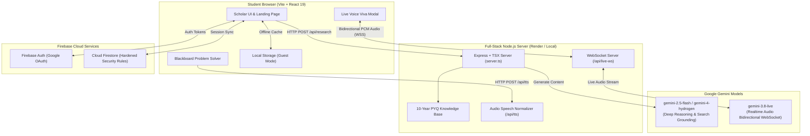

# 🎓 Madhyamik AI Mitra (মাধ্যমিক এআই মিত্র)

<p align="center">
  
</p>

<p align="center">
  <strong>An autonomous, bilingual study and exam research companion built specifically for West Bengal Board (WBBSE) Class 10 candidates.</strong>
</p>

<p align="center">
  <a href="https://madhyamik-ai-mitra.onrender.com/"></a>
</p>

<p align="center">
  <a href="https://wbbse.wb.gov.in/"></a>
  <a href="https://react.dev/"></a>
  <a href="https://www.typescriptlang.org/"></a>
  <a href="https://vite.dev/"></a>
  <a href="https://tailwindcss.com/"></a>
  <a href="https://ai.google.dev/"></a>
  <a href="https://firebase.google.com/"></a>
</p>

---

## 🌟 Live Demo

Experience the live web app in action:  
👉 **[https://madhyamik-ai-mitra.onrender.com/](https://madhyamik-ai-mitra.onrender.com/)**

> **Note for First-Time Visitors:** Render's free web service spins down after brief inactivity. If the page takes ~30–45 seconds to load initially, it is simply waking up the container.

---

## 📑 Table of Contents

- [🌟 Live Demo](#-live-demo)
- [💡 Why Madhyamik AI Mitra?](#-why-madhyamik-ai-mitra)
- [🚀 Core Features](#-core-features)
  - [1. 10-Year PYQ Bank & ABTA/WBTA Frequency](#1--10-year-pyq-bank--abtawbta-frequency-intelligence)
  - [2. Interactive Blackboard Teacher](#2--the-interactive-blackboard-teacher-ব্ল্যাকবোর্ড-শিক্ষক)
  - [3. Real-Time Oral Viva Voice Tutor](#3--real-time-oral-viva--voice-tutor-gemini-live-websocket)
  - [4. True Bilingual Mirroring (বাংলা & English)](#4--true-bilingual-mirroring-বাংলা--english)
  - [5. Multi-Format Paper & Syllabus Upload](#5--multi-format-paper--syllabus-upload)
  - [6. Hallucination-Free YouTube Educational Grounding](#6--hallucination-free-youtube-educational-grounding)
  - [7. Guest Student Mode & Cloud Persistence](#7--guest-student-mode--cloud-persistence)
- [🏗️ System Architecture](#️-system-architecture)
- [🛠️ Tech Stack & Libraries](#️-tech-stack--libraries)
- [⚡ Getting Started (Local Development)](#-getting-started-local-development)
- [🧪 Testing & Verification](#-testing--verification)
- [🌐 Production Deployment](#-production-deployment)
- [🔒 Security & Privacy](#-security--privacy)
- [👨‍💻 Author & Acknowledgments](#-author--acknowledgments)

---

## 💡 Why Madhyamik AI Mitra?

Every year, over **10 lakh students** across West Bengal sit for the **Madhyamik Pariksha** (WBBSE Class 10 secondary examination). For most students in government and rural schools, this is the very first high-stakes board examination of their lives.

Generic AI chatbots often fail Madhyamik candidates:
- They explain concepts using CBSE/ICSE terms and out-of-syllabus textbooks.
- They cannot break down Bengali numericals from physical science or theorem proofs step-by-step.
- They lack awareness of test-paper patterns from **ABTA** (All Bengal Teachers' Association) and **WBTA** (West Bengal Teachers' Association).
- They provide zero oral preparation for classroom viva and school test exams.

**Madhyamik AI Mitra** was handcrafted to solve these exact hurdles. It pairs a **10-Year WBBSE PYQ database (2016–2026)** with real-time **Gemini 2.5 & 3.8 Live models**, offering students an attentive, bilingual digital tutor that behaves just like a patient school teacher at a green chalkboard.

---

## 🚀 Core Features

### 1. 📚 10-Year PYQ Bank & ABTA/WBTA Frequency Intelligence
- Direct chapter-wise indexing across **all 7 WBBSE subjects**:
  - *Physical Science (ভৌত বিজ্ঞান)*
  - *Life Science (জীবন বিজ্ঞান)*
  - *Mathematics (গণিত)*
  - *History (ইতিহাস)*
  - *Geography (ভূগোল)*
  - *Bengali (বাংলা)*
  - *English (ইংরেজি)*
- Classifies each query by board pattern: **1-Mark MCQs / VSA**, **2-Mark Concept Questions**, **3-Mark & 5-Mark Numericals / Broad Questions**, and **8-Mark History Essays**.
- Real-time badges indicate:
  - `High Probability (সম্ভাব্য প্রশ্ন)`: Recurring themes across consecutive board sessions.
  - `Repeated Trend (পুনরাবৃত্ত প্রশ্ন)`: Common questions spotted across ABTA and WBTA test papers.
  - `Concept Builder (ধারণা স্পষ্টীকরণ)`: Foundational topics required to score 90%+ in Madhyamik.

### 2. 🟢 The Interactive Blackboard Teacher (ব্ল্যাকবোর্ড শিক্ষক)
- Dedicated step-by-step problem solver exclusively for **Mathematics** and **Physical Science**.
- Modeled after a supportive teacher standing at a green chalkboard:
  - Breaks long equations and proofs into **digestible chalk sections** instead of overwhelming students with walls of text.
  - Requires the student to confirm understanding (*"আমি বুঝতে পেরেছি, পরবর্তী ধাপে চলুন"* / *"পরের ধাপ"*) before moving forward.
  - **Dynamic Simplification (Levels 1–5)**: If a student clicks *"সহজ ভাষায় বোঝান"*, the tutor rewrites the step using intuitive real-world analogies (e.g., using coins, tea cups, or football fields).
  - Built-in **Teacher Audio Narration** synthesized with proper Bengali and English mathematical phonetics.

### 3. 🎙️ Real-Time Oral Viva & Voice Tutor (Gemini Live WebSocket)
- Full-duplex, low-latency oral examination powered by `gemini-3.8-live` over persistent WebSockets (`/api/live-ws`).
- Mirrors real Madhyamik viva sessions: the AI asks 1-mark and 2-mark conceptual questions verbally, listens to the student's spoken Bengali or English answer, praises correct logic, and gently corrects mistakes.
- Live animated audio visualizer with real-time bidirectional transcript streaming.
- Summarized viva transcripts are automatically stored in the student's study session for quick pre-exam review.

### 4. 🗣️ True Bilingual Mirroring (বাংলা & English)
- If the student writes or speaks in **Bengali** (or informal **Banglish**): the AI responds entirely in clean, idiomatic Bengali script (বাংলা), matching textbook terminology from WBBSE-approved publishers.
- If the student asks in **English**: the response adopts crisp academic English tailored for English-medium WBBSE candidates.
- Phonetic normalizer translates LaTeX equations, Greek symbols ($\theta, \alpha, \lambda, \Delta$), and chemical subscripts ($H_2O, CO_2$) into naturally spoken audio.

### 5. 📄 Multi-Format Paper & Syllabus Upload
- Students can upload snapshots or documents of homework questions, textbook pages, and school test papers.
- Supports **Images (`.png`, `.jpg`, `.webp`)**, **PDFs (`.pdf`)**, and **Text notes (`.txt`)**.
- The server extracts the problem statement, identifies the chapter, and maps it directly against the WBBSE syllabus.

### 6. 🎥 Hallucination-Free YouTube Educational Grounding
- Curated video lectures aligned with WBBSE Class 10 concepts.
- Every YouTube link is actively validated via YouTube's oEmbed protocol before being rendered, completely eliminating broken, private, or hallucinated video embeds.

### 7. 🔐 Guest Student Mode & Cloud Persistence
- **Instant Guest Mode**: Students can jump in, ask questions, solve problems, and practice voice viva immediately with zero friction using local storage.
- **Google Sign-In**: Optional Google OAuth login synchronizes study sessions, uploaded papers, and chat history seamlessly across phones, tablets, and laptops via hardened Cloud Firestore rules.

---

## 🏗️ System Architecture



---

## 🛠️ Tech Stack & Libraries

| Domain | Technologies |
|---|---|
| **Frontend Framework** | [React 19](https://react.dev/), [TypeScript 5](https://www.typescriptlang.org/), [Vite 8](https://vite.dev/) |
| **Styling & Animation** | [Tailwind CSS 4](https://tailwindcss.com/), [Motion (Framer Motion 12)](https://motion.dev/), [Lucide React](https://lucide.dev/) |
| **Typography & Markdown** | [React Markdown](https://github.com/remarkjs/react-markdown), [Remark GFM](https://github.com/remarkjs/remark-gfm), KaTeX notation support |
| **Backend Runtime** | [Node.js 22+](https://nodejs.org/), [Express 4](https://expressjs.com/), [TSX](https://github.com/privatenumber/tsx), [WebSocket (`ws`)](https://github.com/websockets/ws) |
| **AI Models & SDK** | [`@google/genai`](https://www.npmjs.com/package/@google/genai) — `gemini-2.5-flash`, `gemini-3.8-live`, `gemini-3.8-flash-lite-tts` |
| **Cloud Database & Auth** | [Google Firebase Auth](https://firebase.google.com/docs/auth), [Cloud Firestore](https://firebase.google.com/docs/firestore) |

---

## ⚡ Getting Started (Local Development)

### Prerequisites
- **Node.js** v20.0.0 or higher
- **npm** (or `pnpm` / `bun`)
- A **Google Gemini API Key** from [Google AI Studio](https://aistudio.google.com/)

### 1. Clone the Repository
```bash
git clone https://github.com/pradipta2005/madhyamik-AI-mitra.git
cd madhyamik-AI-mitra
```

### 2. Install Dependencies
```bash
npm install
```

### 3. Setup Environment Variables
Create a `.env` file in the project root:
```bash
cp .env.example .env
```
Open `.env` and add your Gemini API Key:
```env
GEMINI_API_KEY="your-google-gemini-api-key-here"
PORT=3000
```
*(Your Firebase configuration is already pre-configured in `firebase-applet-config.json` for client authentication and database sync).*

### 4. Start the Development Server
```bash
npm run dev
```
Open [http://localhost:3000](http://localhost:3000) in your browser.

---

## 🧪 Testing & Verification

The project includes an automated test suite verifying prompt classification, Bengali token normalization, PYQ retrieval, and Firestore security rules:

```bash
# Run unit & security tests
npm test

# Run TypeScript type check
npm run lint

# Compile optimized production bundle
npm run build
```

---

## 🌐 Production Deployment

### Deploying to Render (Recommended)
This repository is pre-configured for instant deployment on [Render](https://render.com):
1. Create a new **Web Service** on Render and select your GitHub repository.
2. Set the configuration:
   - **Environment:** `Node`
   - **Build Command:** `npm install && npm run build`
   - **Start Command:** `npm start`
3. Add the environment variable:
   - `GEMINI_API_KEY`: *(Your Google AI Studio API key)*
4. Once deployed, copy your Render domain (`your-app.onrender.com`) and add it to **Firebase Console → Authentication → Settings → Authorized domains**.

---

## 🔒 Security & Privacy

- **Server-Side API Key Protection**: The secret `GEMINI_API_KEY` is never exposed to the client bundle. All Gemini inference requests pass through the authenticated Express proxy.
- **Firebase Firestore Security Rules**: Documents are locked under `/users/{userId}/...` paths. Cloud rules enforce owner verification (`request.auth.uid == userId`) and include a strict global default-deny safety net.
- **Data Minimization**: Guest students can use all core features purely inside `localStorage` without handing over an email or personal details.

---

## 👨‍💻 Author & Acknowledgments

Crafted with dedication by **[Pradipta](https://github.com/pradipta2005)** for West Bengal Board students.

- **Syllabus Reference:** West Bengal Board of Secondary Education (WBBSE), Nivedita Bhavan, Kolkata.
- **Test Paper References:** All Bengal Teachers' Association (ABTA) & West Bengal Teachers' Association (WBTA) Madhyamik Test Papers.
- **AI Infrastructure:** Google DeepMind & Google AI Studio (Gemini Live API & Hydrogen reasoning).

---

<p align="center">
  <sub>Made with ❤️ for Madhyamik 2026 aspirants across West Bengal. শুভকামনা! 🌟</sub>
</p>
